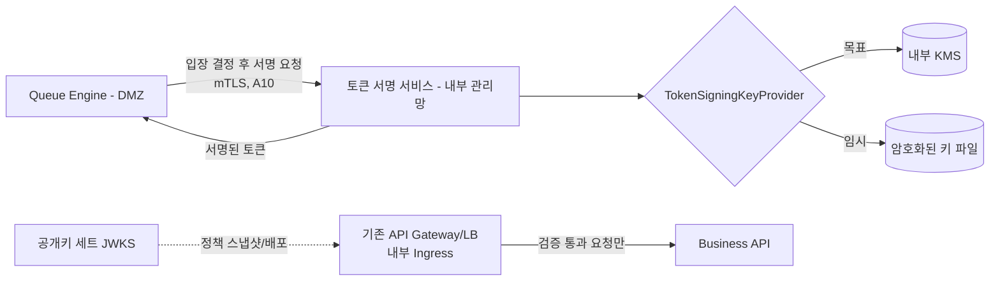

# ADR-0005: 입장 토큰 서명 및 내부 Ingress 검증 (DEC-03, DEC-08)

- 상태: **승인(소유자 2026-11-14, 권고안 채택)** — §3 임시 대안(관리망 파일 기반 키)·§4 알고리즘 순서(Ed25519 → ES256) 포함.
  기존 API Gateway/LB의 Ed25519 지원 여부는 Phase 6 전 확인. A10은 보안팀 검토 권장
- 영향도 등급: I4 (암호키 보관·서명 방식·Zone 간 통신 추가) → 보안팀 승인 필요

## 1. 결정된 원칙

- 서명 개인키는 **내부 관리망의 KMS**에 둔다(DEC-03). DMZ에는 공개키만 둔다.
- 내부 Ingress는 **기존 API Gateway/LB**를 사용한다(DEC-08). OpenQueue는 Ingress를 새로 만들지 않고,
  기존 게이트웨이가 토큰을 검증할 수 있도록 **검증 규격(claim·알고리즘·공개키 배포)**을 제공한다.

## 2. 구조

- 코드는 `TokenSigningKeyProvider` 인터페이스 뒤에 키 보관 방식을 숨긴다. KMS 구현과 임시 구현을 **설정으로 교체**하며
  서명 서비스·토큰 형식·검증 측은 바뀌지 않는다.

## 3. 임시 대안 (KMS 연동 전): 내부 관리망의 파일 기반 키

| 항목 | 내용 |
|---|---|
| 키 위치 | 토큰 서명 서비스 호스트(**내부 관리망**)의 파일. DMZ에는 두지 않는다 |
| 형식 | 암호화된 PKCS#8 PEM. 복호화 비밀번호는 환경변수/Secret 파일로 주입(저장소·이미지에 포함 금지) |
| 권한 | 서명 서비스 전용 OS 계정만 읽기(0400) |
| 키 생성 | 설치 스크립트가 설치 시점에 생성(`scripts/`, Phase 6). 저장소에 키 커밋 금지 |
| 키 식별·교체 | `kid` 부여, 새 키 추가 → 공개키 배포 → 서명 키 전환 → 이전 키 만료 후 제거 |
| DMZ 요청 제한 | mTLS 클라이언트 인증, 정책 스냅샷에 있는 site_id/queue_id만 허용, `exp` 상한(예: 5분), 노드별 발급량 상한, 전 건 감사 |
| 종료 조건 | KMS 연동 완료 시 `KmsTokenSigningKeyProvider`로 전환하고 파일 키 폐기 |

**채택하지 않은 대안**: DMZ 노드에 개인키 파일을 두는 방식. 가장 단순하지만 DMZ 침해 시 공격자가 토큰을
무제한 위조할 수 있어 설계서 §5.4("보안 승인 없이 채택하지 않는다")에 따라 제외했다.

**추가되는 통신**: port-matrix **A10**(DMZ Queue Engine → 내부 토큰 서명 서비스, mTLS). DMZ에서 내부로 여는 연결이므로
보안팀 승인 대상이다. 서명 서비스 장애 시 신규 입장 토큰 발급만 중단되고 기존 토큰 검증은 계속된다(설계서 §12.2).

## 4. 알고리즘 — 기존 게이트웨이 호환성 확인 필요

설계 원칙은 Ed25519(JWS `EdDSA`) 우선이다. 다만 DEC-08로 **기존 게이트웨이가 토큰을 검증**하게 되었으므로,
그 제품이 `EdDSA`를 지원하지 않으면 사용할 수 없다.

| 알고리즘 | 장점 | 고려 |
|---|---|---|
| EdDSA (Ed25519) | 설계 원칙, 빠르고 구현 실수 여지가 적음 | 일부 게이트웨이·KMS 미지원 |
| ES256 (ECDSA P-256) | 대부분 게이트웨이·KMS가 지원 | 서명 구현 품질에 민감 |

결정 방법: 기존 API Gateway/LB 제품과 KMS 제품이 공통으로 지원하는 알고리즘 중 **EdDSA → ES256** 순으로 선택한다.
알고리즘은 설정값으로 두고 토큰 헤더 `alg`와 `kid`로 식별한다. `none`·HMAC 계열은 검증 측에서 거부한다.

## 5. 기존 게이트웨이가 검증할 항목 (TOK-002 계약 초안)

서명(`kid`로 공개키 선택), `iss`, `aud`, `exp`, `nbf`, `site_id`, `queue_id`, `scope`.
`jti` 재사용 방지(TOK-003)는 기존 게이트웨이가 상태 저장소를 지원하는지에 따라 구현 위치가 달라진다(Phase 6에서 결정).
