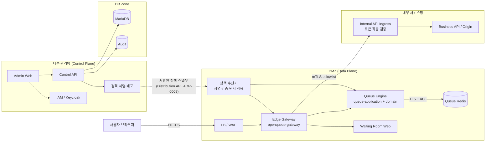

# OpenQueue 전체 아키텍처

- 문서 버전: 0.1 (TASK-000)
- 원본: [openqueue_architecture_security_design_ko.md](../openqueue_architecture_security_design_ko.md) — 본 문서는 구현 관점 요약이며, 충돌 시 원본 설계서가 우선한다.

## 1. Zone 배치

**금지 경로** (NET-001, NET-006): DMZ → DB Zone, DMZ → 내부 관리망(승인된 배포·상태 보고 채널 제외), Internet → Redis/관리망/Origin.

## 2. Control Plane / Data Plane 책임

| 구분 | Control Plane (내부 관리망) | Data Plane (DMZ) |
|---|---|---|
| 데이터 원천 | MariaDB (사이트·서비스·정책·감사) | 서명된 정책 스냅샷(메모리) + Queue Redis(대기 상태) |
| 주요 책임 | 정책 생성·검증·승인·서명·배포, RBAC, 감사 | 요청 수신, 대기열 운영, 입장 제어, 라우팅 |
| 장애 시 | Data Plane은 마지막 정상 정책으로 계속 운영 | 사이트별 Fail-open/closed (DEC-09, 미결정) |

## 3. 요청 처리 흐름 (설계서 §8.1)

1. 사용자 → LB/WAF → Edge Gateway
2. Gateway가 Host/path로 사이트·정책 식별 (GAT-001)
3. 대기열 비활성 또는 입장 허용 상태 → 승인된 서비스 ID 라우트로 전달 (GAT-002)
4. 대기열 활성 → Queue Engine이 Redis에 대기 세션 등록 (QUE-001/003/008)
5. Waiting Room이 SSE로 순번·예상 대기시간 표시 (WUI-001)
6. Queue Engine이 동시 입장 상한·FIFO로 입장 세션 선정 (QUE-001/005)
7. 짧은 수명의 서명 입장 토큰 발급 (TOK-001, 서명 위치 DEC-03)
8. 브라우저 재요청 → Gateway → Internal API Ingress가 토큰·scope 재검증 (TOK-002/003)

## 4. 구현 현황

| 구성요소 | 상태 |
|---|---|
| Queue 도메인: FIFO 선정·멱등성 (QUE-001) | 구현·단위 테스트 통과 (TASK-000 샘플) |
| 그 외 전부 | 미착수 — Phase 계획은 개발요청서 §9 |
