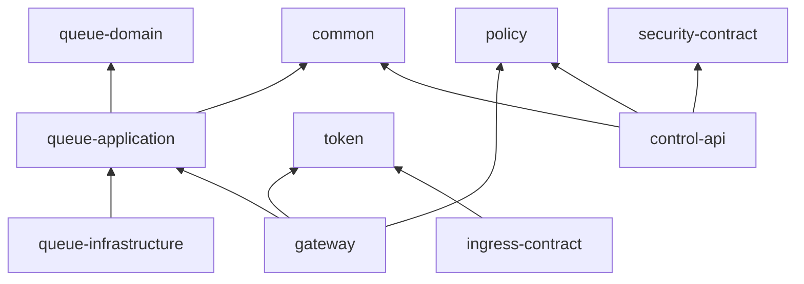

# 모듈 책임과 의존성

- 문서 버전: 0.1 (TASK-000)
- 관련: 개발요청서 §6, 설계서 §9, [ADR-0003](../adr/ADR-0003-module-boundary-enforcement.md)

## 1. 모듈 목록

| Maven 모듈 | 설계서 모듈 | 배치 Zone | 책임 | 생성 Phase | 상태 |
|---|---|---|---|---|---|
| `openqueue-queue-domain` | M02 | DMZ | 대기열 업무 규칙(FIFO, 입장 선정, 멱등성, 상태 전이). 순수 Java | 0 | **생성됨** |
| `openqueue-common` | - | 공통 | 오류 코드 계약, 요청 ID 등 Zone 무관 공통 타입. 업무 로직 금지 | 1 | 예정 |
| `openqueue-queue-application` | M02 | DMZ | 대기 등록·조회·취소·입장 유스케이스, 포트(인터페이스) 정의 | 1 | 예정 |
| `openqueue-queue-infrastructure` | M04 | DMZ | Redis Adapter, Lua Script, TLS/ACL 연결 | 2 | **생성됨** (TASK-005, DB 드라이버 금지 enforcer 적용) |
| `openqueue-gateway` | M01, M06 | DMZ | Spring Cloud Gateway, 사이트 식별, 라우팅, SSRF 방어 | 4 | 예정 |
| `openqueue-control-api` | M09, M10, M11, M12 | 내부 관리망 | 관리 API, Registry, RBAC, 감사, MariaDB 연계 | 5 | 예정 |
| `openqueue-policy` | M07 | 공유 계약 | 정책 스냅샷 schema, canonical 직렬화, **서명 검증**(DMZ)·서명 인터페이스 | 6 | 예정 |
| `openqueue-token` | M05 | 공유 계약 | 토큰 claim 모델, 검증기, 발급 인터페이스 | 6 | 예정 |
| `openqueue-security-contract` | M11 | 공유 계약 | 인증·인가 공통 계약(역할, 권한 상수) | 5 | 예정 |
| `openqueue-ingress-contract` | M13 | 내부 서비스망 | Internal Ingress 토큰 검증 계약·라이브러리 | 6 | 예정 |

> 서명 **개인키 사용 코드**는 DMZ 실행 모듈에 포함되지 않도록 `openqueue-policy`·`openqueue-token` 내부에서
> 검증(verify) 패키지와 서명(sign) 구현을 분리한다. 분리 방식은 Phase 6 ADR에서 확정한다.

## 2. 의존 방향

규칙:

1. 화살표 반대 방향 의존과 순환 의존을 금지한다.
2. `queue-domain`은 어떤 모듈·라이브러리에도 의존하지 않는다 (**enforcer로 강제 중**).
3. DMZ 실행 모듈(`gateway`, `queue-*`)은 `control-api`와 DB 드라이버·Flyway에 의존할 수 없다 (모듈 생성 시 enforcer 적용).
4. `control-api`는 DMZ 실행 모듈(`gateway`, `queue-infrastructure`)에 의존할 수 없다.
5. 같은 저장소에 있어도 DMZ와 내부 관리망 산출물은 별도 프로세스·컨테이너·서비스 계정으로 배포한다.

## 3. 계층 책임

| 계층 | 둘 수 있는 것 | 두면 안 되는 것 |
|---|---|---|
| domain | 엔티티, 값 객체, 도메인 규칙, 상태 전이 | 프레임워크, I/O, 로그, 시간 직접 조회(Clock 주입) |
| application | 유스케이스, 트랜잭션 경계, 포트 인터페이스 | SQL, Redis 명령, HTTP 세부 |
| infrastructure | Adapter/Repository 구현, Lua/SQL 파일 로딩 | 업무 규칙 |
| gateway / control-api | Controller, 필터, 입력 매핑, 오류 매핑 | 업무 규칙 |
